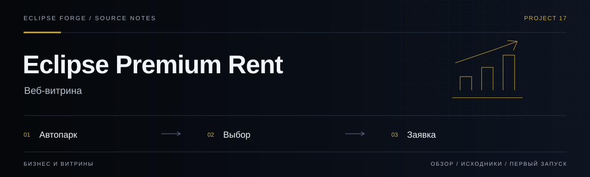

# Eclipse Premium Rent

<!-- project-links:start -->
[Открыть веб-версию](https://eclipse-premiumrent.pages.dev) · [Документация](docs/repository-guide.md) · [Код](https://github.com/PavelHopson/Eclipse-PremiumRent/tree/main) · [История изменений](https://github.com/PavelHopson/Eclipse-PremiumRent/commits/main/)
<!-- project-links:end -->



**Веб-витрина.** Витрина премиальной аренды автомобилей в Калининграде: каталог и путь к заявке.

<!-- eclipse-forge-projects:start -->
## Проекты Eclipse Forge

[Главная Eclipse Forge](https://eclipse-forge.ru/) · [Eclipse Library](https://library.eclipse-forge.ru/) · [Eclipse DnD Forge](https://dnd.eclipse-forge.ru/)

Исходный код: [Eclipse Forge Landing](https://github.com/PavelHopson/Eclipse-forge-website) · [Eclipse Chat](https://github.com/PavelHopson/eclipse-chat) · [Eclipse Connect](https://github.com/PavelHopson/eclipse-connect) · [Eclipse Library](https://github.com/PavelHopson/eclipse-library) · [Eclipse AI Hub](https://github.com/PavelHopson/eclipse-ai-hub) · [Eclipse Ultron / Sentinel](https://github.com/PavelHopson/eclipse-hopson-sentinel) · [Eclipse Webclaw](https://github.com/PavelHopson/Eclipse-webclaw) · [Eclipse DnD Forge](https://github.com/PavelHopson/eclipse-dnd-forge) · [Finflow](https://github.com/PavelHopson/finflow) · [Eclipse Media](https://github.com/PavelHopson/eclipse-media) · [Shotforge](https://github.com/PavelHopson/shotforge) · [Text2Image](https://github.com/PavelHopson/Text2Image) · [Educator AI](https://github.com/PavelHopson/Educator-AI) · [@pavelhopson/retry-http](https://github.com/PavelHopson/retry-http)
<!-- eclipse-forge-projects:end -->

<!-- repository-guide:start -->
[Первый запуск](#readme-start) · [Что внутри](#readme-map) · [Путеводитель](docs/repository-guide.md#start) · [Карта кода](docs/repository-guide.md#map) · [Проверки](docs/repository-guide.md#checks) · [Границы и права](docs/repository-guide.md#boundaries)

<a id="readme-map"></a>

## Проект за минуту

- **[Автопарк](<src/data.ts>)** — Контент каталога автомобилей.
- **[Заявка](<src/components/BookingWizard.tsx>)** — Интерфейс пошагового выбора параметров аренды.
- **[Состояние выбора](<src/store.ts>)** — Клиентское состояние витрины.

<a id="readme-start"></a>

## Начать локально

**Среда:** Node.js и npm. **Источник:** [package.json](<package.json>).

Из корня клонированного репозитория:

```bash
npm ci
npm run dev
```

Запуск сервера разработки не выполняет публикацию. Проверьте настройки окружения и основной пользовательский сценарий перед выпуском.

<details>
<summary><strong>Перед первым запуском и изменением кода</strong></summary>

- Команды сверены с исходниками 8 сентября 2026. Это инструкция, а не отметка об успешном запуске или текущем production.
- Установка зависимостей может обращаться в registry и выполнять lifecycle scripts. Используйте отдельную рабочую среду и демонстрационные данные.
- Цены, доступность автомобилей и отзывы перед публикацией проверяются владельцем бизнеса; UI не подтверждает реальное бронирование.


</details>
<!-- repository-guide:end -->

## О проекте

**Eclipse Premium Rent** — веб-приложение для сервиса аренды автомобилей премиум-класса, ориентированного исключительно на Калининград и Калининградскую область.

Дизайн вдохновлён лучшими практиками luxury-сегмента автопроката: тёмная цветовая схема, элегантная типографика, продуманные микровзаимодействия и mobile-first подход.

<br>

## Ключевые особенности

<table>
<tr>
<td width="50%">

### 🎨 Дизайн
- Тёмная премиальная тема с золотыми акцентами
- Минималистичная эстетика класса luxury
- Плавные анимации и переходы (Framer Motion)
- Полностью адаптивный интерфейс

</td>
<td width="50%">

### ⚡ Функциональность
- Мега-меню с каталогом классов и марок
- Горизонтальные карусели по 7 категориям
- 5-шаговый визард бронирования
- Форма поиска с датами и локациями

</td>
</tr>
<tr>
<td>

### 🚗 Каталог
- 20+ автомобилей в 7 категориях
- Внедорожники, Премиум, Бизнес, Спорткары
- Минивэны, Комфорт, Электромобили
- Карточки с ценами, бейджами, избранным

</td>
<td>

### 🌍 Региональный фокус
- Калининград, Храброво, Зеленоградск, Светлогорск
- SEO-контент для Калининградской области
- Куршская коса, Балтийское побережье
- Исключительно локальный контекст

</td>
</tr>
</table>

<br>

## Архитектура

```
src/
├── components/
│   ├── Navbar.tsx           # Навигация с мега-меню
│   ├── Hero.tsx             # Главный экран
│   ├── SearchForm.tsx       # Форма поиска
│   ├── CategorySelector.tsx # Категории автомобилей
│   ├── CarCarousel.tsx      # Карусель по категориям
│   ├── CarCard.tsx          # Карточка автомобиля
│   ├── BookingWizard.tsx    # 5-шаговое бронирование
│   ├── ClientsSection.tsx   # Известные клиенты
│   ├── InfoSection.tsx      # SEO + преимущества
│   └── Button.tsx           # UI-компонент
├── App.tsx                  # Корневой компонент
├── store.ts                 # Zustand state management
├── data.ts                  # Каталог авто, клиенты, марки
├── types.ts                 # TypeScript интерфейсы
├── index.css                # Tailwind + кастомные стили
└── main.tsx                 # Точка входа
```

<br>

## Стек технологий

| Технология | Версия | Назначение |
|:-----------|:------:|:-----------|
| **React** | 19 | UI-библиотека |
| **TypeScript** | 5.6 | Типизация |
| **Vite** | 6 | Сборщик |
| **Tailwind CSS** | 4 | Стили |
| **Zustand** | 5 | State management |
| **Framer Motion** | 12 | Анимации |
| **Lucide React** | — | Иконки |
| **Cloudflare Pages** | — | Хостинг и CDN |

<br>

## Дизайн-система

```
Цвета:
  Primary (CTA)     #2BB673    ████  — кнопки, акценты действий
  Gold (Premium)     #C9A96E    ████  — навигация, премиальные элементы
  Secondary          #FF3B30    ████  — скидки, акции
  Background         #0A0A0A    ████  — основной фон
  Card               #141414    ████  — карточки, панели
  Border             #222222    ████  — разделители

Типографика:
  Font               Inter (300, 400, 500, 600, 700)
  Hero               text-7xl / font-light / tracking-[0.15em]
  Section titles     text-2xl / font-light / italic
  Body               text-[15px] / text-white/40–90
```

<br>

## Быстрый старт

```bash
# Клонирование
git clone https://github.com/PavelHopson/Eclipse-PremiumRent.git
cd Eclipse-PremiumRent

# Установка зависимостей
npm install

# Разработка
npm run dev

# Продакшен-сборка
npm run build

# Предпросмотр сборки
npm run preview
```

<br>

## Секции сайта

| # | Секция | Описание |
|:-:|:-------|:---------|
| 1 | **Hero** | Полноэкранный баннер с логотипом, заголовком и CTA |
| 2 | **Поиск** | Форма с локацией, датами получения и возврата |
| 3 | **Категории** | Визуальный ряд из 7 категорий с изображениями |
| 4 | **Каталог** | Карусели автомобилей по каждой категории |
| 5 | **Клиенты** | Известные персоны с фотографиями и описаниями |
| 6 | **О компании** | SEO-текст, 6 преимуществ, блок для юрлиц |
| 7 | **Бронирование** | 5-шаговый визард: поиск → авто → опции → данные → оплата |

<br>

## Проверка производительности

Размер bundle и время сборки измеряйте для конкретного commit через `npm run build`. Скорость страницы проверяйте отдельно на выбранном устройстве и соединении. Прежние численные оценки не снабжены воспроизводимым отчётом и не используются как актуальные показатели проекта.

<br>

---

<div align="center">

<br>

**Eclipse Premium Rent** — кейс-проект по созданию премиального веб-приложения для автопроката

<br>

[](https://github.com/PavelHopson)

<br>

</div>
