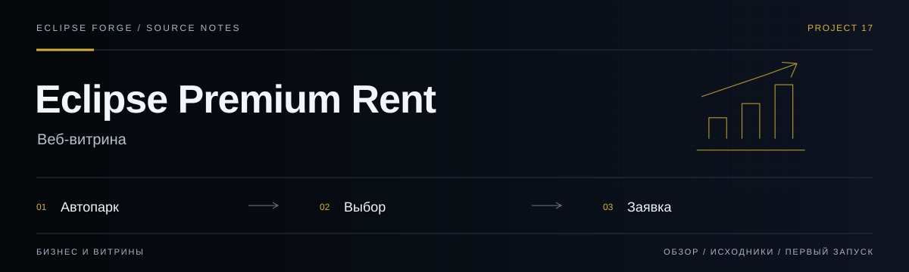

# Eclipse Premium Rent

<!-- project-links:start -->
[Открыть веб-версию](https://eclipse-premiumrent.pages.dev) · [Документация](docs/repository-guide.md) · [Код](https://github.com/PavelHopson/Eclipse-PremiumRent/tree/main) · [История изменений](https://github.com/PavelHopson/Eclipse-PremiumRent/commits/main/)
<!-- project-links:end -->



**Веб-витрина.** Витрина премиальной аренды автомобилей в Калининграде: каталог и путь к заявке.

<!-- eclipse-forge-projects:start -->
## Проекты Eclipse Forge

[Главная Eclipse Forge](https://eclipse-forge.ru/) · [Eclipse Library](https://library.eclipse-forge.ru/) · [Eclipse DnD Forge](https://dnd.eclipse-forge.ru/)

Исходный код: [Eclipse Forge Landing](https://github.com/PavelHopson/Eclipse-forge-website) · [Eclipse Chat](https://github.com/PavelHopson/eclipse-chat) · [Eclipse Library](https://github.com/PavelHopson/eclipse-library) · [Eclipse AI Hub](https://github.com/PavelHopson/eclipse-ai-hub) · [Eclipse Sentinel](https://github.com/PavelHopson/eclipse-hopson-sentinel) · [Eclipse Webclaw](https://github.com/PavelHopson/Eclipse-webclaw) · [Eclipse DnD Forge](https://github.com/PavelHopson/eclipse-dnd-forge) · [Finflow](https://github.com/PavelHopson/finflow) · [Eclipse Media](https://github.com/PavelHopson/eclipse-media) · [Shotforge](https://github.com/PavelHopson/shotforge) · [Text2Image](https://github.com/PavelHopson/Text2Image) · [Educator AI](https://github.com/PavelHopson/Educator-AI) · [@pavelhopson/retry-http](https://github.com/PavelHopson/retry-http)
<!-- eclipse-forge-projects:end -->

<!-- repository-guide:start -->
[Первый запуск](#readme-start) · [Что внутри](#readme-map) · [Путеводитель](docs/repository-guide.md#start) · [Карта кода](docs/repository-guide.md#map) · [Проверки](docs/repository-guide.md#checks) · [Границы и права](docs/repository-guide.md#boundaries)

<a id="readme-map"></a>

## Проект за минуту

- **[Автопарк](<src/data.ts>)** — Контент каталога автомобилей.
- **[Заявка](<src/components/BookingWizard.tsx>)** — Интерфейс пошагового выбора параметров аренды.
- **[Состояние выбора](<src/store.ts>)** — Клиентское состояние витрины.

<a id="readme-start"></a>

## Начать локально

**Среда:** Node.js и npm. **Источник:** [package.json](<package.json>).

Из корня клонированного репозитория:

```bash
npm ci
npm run dev
```

Запуск сервера разработки не выполняет публикацию. Проверьте настройки окружения и основной пользовательский сценарий перед выпуском.

<details>
<summary><strong>Перед первым запуском и изменением кода</strong></summary>

- Команды сверены с исходниками 8 сентября 2026. Это инструкция, а не отметка об успешном запуске или текущем production.
- Установка зависимостей может обращаться в registry и выполнять lifecycle scripts. Используйте отдельную рабочую среду и демонстрационные данные.
- Цены, доступность автомобилей и отзывы перед публикацией проверяются владельцем бизнеса; UI не подтверждает реальное бронирование.


</details>
<!-- repository-guide:end -->

## О проекте

Демонстрационная витрина аренды автомобилей: каталог по категориям, выбор дат и пример расчёта. Цены, автомобили и локации приведены для примера; наличие не проверяется. **Бронирование, оплата и отправка заявок не подключены.** Используйте вымышленные данные.

Главная страница, каталог и мобильная навигация адаптированы под разные экраны. Кнопки выбора ведут к демонстрационному расчёту, даты проверяются в браузере.

Изображения загружаются с внешних сайтов. Их доступность и права на использование для публичного или коммерческого размещения необходимо проверить отдельно.

## Разработка и проверки

```bash
npm ci
npm run dev
npm run typecheck
npm run build
```

Приложение использует React, TypeScript, Vite, Tailwind CSS, Zustand и Framer Motion. Основные стили витрины — `src/premium.css`, расчёт — `src/components/BookingWizard.tsx`. Проверяйте на реальном экране и не считайте локальную сборку подтверждением публикации.
